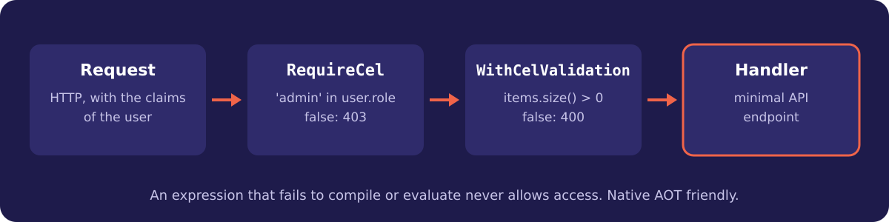

# Great.Parts.Cel.AspNetCore


[](https://www.nuget.org/packages/Great.Parts.Cel.AspNetCore)
[](https://www.nuget.org/packages/Great.Parts.Cel.AspNetCore)
[](https://github.com/great-parts/great-parts-cel/actions/workflows/ci.yml)
[](https://www.bestpractices.dev/projects/16897)
[](https://scorecard.dev/viewer/?uri=github.com/great-parts/great-parts-cel)
[](https://github.com/great-parts/great-parts-cel/blob/main/LICENSE)

ASP.NET Core support for [Great.Parts.Cel](https://www.nuget.org/packages/Great.Parts.Cel), the CEL (Common Expression Language) library for .NET / C#.

CEL expressions in authorization policies, `policy.RequireCel("'admin' in user.role")`, and in the validation of requests of minimal API endpoints, `WithCelValidation<CreateOrder>("items.size() > 0", "The order has no items")`. The rules are text, so they can live in configuration or a database. The package uses no reflection, and the endpoint filter works under Native AOT.



Documentation: start with [Getting Started](https://github.com/great-parts/great-parts-cel/blob/main/docs/getting-started.md), seven short scenarios from the first expression to a web service; the pages are listed in the Documentation section below.

## Install

The package targets `net10.0` and `net11.0`, uses the shared framework `Microsoft.AspNetCore.App` and depends on `Great.Parts.Cel.DependencyInjection`:

```shell
dotnet add package Great.Parts.Cel.AspNetCore
```

## Use

Register the CEL environment with the dependency injection package, then add the handler of the policies:

```csharp
using Great.Parts.Cel.AspNetCore;
using Great.Parts.Cel.DependencyInjection;

builder.Services.AddCel(b => b.SetDefaultCostLimit(10_000));
builder.Services.AddCelAuthorization();

builder.Services.AddAuthorizationBuilder()
    .AddPolicy("SalesManager", policy => policy
        .RequireAuthenticatedUser()
        .RequireCel("'manager' in user.role && user.department == ['sales']"));
```

The expression sees the claims of the user as `user`, a map from the claim type to the list of its values. An expression that fails to compile or to evaluate denies access; an error never allows it.

Validate the body of a request before the handler runs (the type of the request is described by a type context of the environment, see `Great.Parts.Cel`):

```csharp
app.MapPost("/orders", (CreateOrder order) => Results.Created($"/orders/{order.Id}", order))
   .WithCelValidation<CreateOrder>("items.size() > 0 && total >= 0", "The order is empty or the total is negative");
```

`false` answers 400 with a validation problem (`application/problem+json`) whose `errors` map holds your message under the empty key, `errors[""]`:

```json
{
  "title": "One or more validation errors occurred.",
  "status": 400,
  "errors": { "": [ "The order is empty or the total is negative" ] }
}
```

A rule that fails to compile or to evaluate answers 400 too, with `detail` set to `The validation rule failed with the error <code>.`, where `<code>` is the `CelErrorCode`; a handler without an argument of the type `CreateOrder` answers 400 with `detail` set to `The request has no argument of the type <type>.`

## For AI coding assistants

The package carries a file `AGENTS.md` in its root: when to use the package, policies and resources, the validation of requests, and the mistakes that are easy to make. The NuGet MCP server returns it with its tool `get_package_context` for a package that is restored on the machine, and a coding agent can read it from the package folder of the NuGet cache.

## Documentation

The documentation of a release is the content of the repository at the tag of the release; until the release of 2.0, the links on this page point to the `main` branch of the repository.

- [Getting Started](https://github.com/great-parts/great-parts-cel/blob/main/docs/getting-started.md): seven scenarios; the sixth is a web service with this package
- [FluentValidation recipe](https://github.com/great-parts/great-parts-cel/blob/main/docs/recipes/fluentvalidation.md)
- [README of the repository](https://github.com/great-parts/great-parts-cel/blob/main/README.md)
- [API concepts](https://github.com/great-parts/great-parts-cel/blob/main/docs/api-concepts.md)
- [Type mapping](https://github.com/great-parts/great-parts-cel/blob/main/docs/type-mapping.md)
- [Error codes](https://github.com/great-parts/great-parts-cel/blob/main/docs/error-codes.md)
- [Versioning and compatibility](https://github.com/great-parts/great-parts-cel/blob/main/docs/versioning.md)
- [Changelog](https://github.com/great-parts/great-parts-cel/blob/main/CHANGELOG.md)

## License

[Apache License 2.0](https://github.com/great-parts/great-parts-cel/blob/main/LICENSE).
