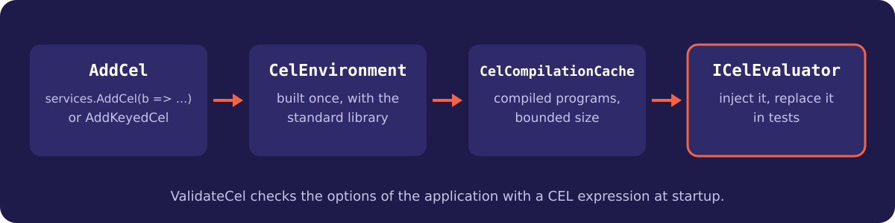

# Great.Parts.Cel.DependencyInjection


[](https://www.nuget.org/packages/Great.Parts.Cel.DependencyInjection)
[](https://www.nuget.org/packages/Great.Parts.Cel.DependencyInjection)
[](https://github.com/great-parts/great-parts-cel/actions/workflows/ci.yml)
[](https://www.bestpractices.dev/projects/16897)
[](https://scorecard.dev/viewer/?uri=github.com/great-parts/great-parts-cel)
[](https://github.com/great-parts/great-parts-cel/blob/v2.0.0/LICENSE)

Dependency injection for [Great.Parts.Cel](https://www.nuget.org/packages/Great.Parts.Cel), the CEL (Common Expression Language) library for .NET / C#.

One call registers a CEL environment, a compilation cache and an `ICelEvaluator` in `Microsoft.Extensions.DependencyInjection`; named environments are keyed services; `ValidateCel` checks the options of the application with a CEL expression. The package reads no configuration and uses no reflection, so it works under trimming and Native AOT, in services without a web host, and in the browser.



Documentation: start with [Getting Started](https://github.com/great-parts/great-parts-cel/blob/v2.0.0/docs/getting-started.md), seven short scenarios from the first expression to a web service; the pages are listed in the Documentation section below.

## Install

The package targets `net10.0` and `net11.0`. It depends on `Great.Parts.Cel`, `Microsoft.Extensions.DependencyInjection.Abstractions` and `Microsoft.Extensions.Options`:

```shell
dotnet add package Great.Parts.Cel.DependencyInjection
```

## Use

Declare the types that rules read in a type context, register the environment, and inject `ICelEvaluator`:

```csharp
using Great.Parts.Cel;
using Great.Parts.Cel.DependencyInjection;
using Great.Parts.Cel.Values;

[CelObject(typeof(Order))]
internal sealed partial class AppTypes : CelTypeContext;

public sealed record Order(long Total, string Currency);

builder.Services.AddCel(b => b
    .AddTypes(AppTypes.Default)
    .UseInput<Order>());

public sealed class PricingRules(ICelEvaluator evaluator)
{
    public bool IsLarge(Order order) =>
        evaluator.EvaluateInput<bool>("total > 100", order).GetValueOrThrow();
}
```

Validate options at startup with an expression over their fields:

```csharp
builder.Services.AddOptions<ShopOptions>()
    .Bind(builder.Configuration.GetSection("Shop"))
    .ValidateCel("maxDiscount <= 50", "The discount is above 50%")
    .ValidateOnStart();
```

## For AI coding assistants

The package carries a file `AGENTS.md` in its root: when to use the package, registration, named environments, settings, the validation of options, and the mistakes that are easy to make. The NuGet MCP server returns it with its tool `get_package_context` for a package that is restored on the machine, and a coding agent can read it from the package folder of the NuGet cache.

## Documentation

The documentation of a release is the content of the repository at the tag of the release; the links on this page point to the tag `v2.0.0` of the repository.

- [Getting Started](https://github.com/great-parts/great-parts-cel/blob/v2.0.0/docs/getting-started.md): seven scenarios; the sixth is a web service with this package
- [FluentValidation recipe](https://github.com/great-parts/great-parts-cel/blob/v2.0.0/docs/recipes/fluentvalidation.md)
- [README of the repository](https://github.com/great-parts/great-parts-cel/blob/v2.0.0/README.md)
- [API concepts](https://github.com/great-parts/great-parts-cel/blob/v2.0.0/docs/api-concepts.md)
- [Type mapping](https://github.com/great-parts/great-parts-cel/blob/v2.0.0/docs/type-mapping.md)
- [Error codes](https://github.com/great-parts/great-parts-cel/blob/v2.0.0/docs/error-codes.md)
- [Versioning and compatibility](https://github.com/great-parts/great-parts-cel/blob/v2.0.0/docs/versioning.md)
- [Changelog](https://github.com/great-parts/great-parts-cel/blob/v2.0.0/CHANGELOG.md)

## License

[Apache License 2.0](https://github.com/great-parts/great-parts-cel/blob/v2.0.0/LICENSE).
