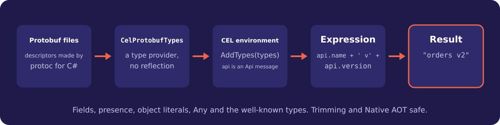

# Great.Parts.Cel.Protobuf


[](https://www.nuget.org/packages/Great.Parts.Cel.Protobuf)
[](https://www.nuget.org/packages/Great.Parts.Cel.Protobuf)
[](https://github.com/great-parts/great-parts-cel/actions/workflows/ci.yml)
[](https://www.bestpractices.dev/projects/16897)
[](https://scorecard.dev/viewer/?uri=github.com/great-parts/great-parts-cel)
[](https://github.com/great-parts/great-parts-cel/blob/v2.0.0/LICENSE)

Protocol Buffers support for [Great.Parts.Cel](https://www.nuget.org/packages/Great.Parts.Cel), the CEL (Common Expression Language) library for .NET / C#.

The package gives a CEL environment the messages of protobuf: expressions read their fields, test their presence, create messages with object literals, compare them and unpack `google.protobuf.Any`. The package depends on `Great.Parts.Cel` and `Google.Protobuf` only, reads and writes fields through the field accessors of `Google.Protobuf` without reflection, and works under trimming and Native AOT.



Documentation: start with [Getting Started](https://github.com/great-parts/great-parts-cel/blob/v2.0.0/docs/getting-started.md), seven short scenarios from the first expression to a web service; the pages are listed in the Documentation section below.

## Install

The package targets `net10.0` and `net11.0`. Add it next to `Great.Parts.Cel`:

```shell
dotnet add package Great.Parts.Cel
dotnet add package Great.Parts.Cel.Protobuf
```

## Use

Build a provider from the descriptors of the files that `protoc` generated for C#, and give it to the environment. The example uses `google.protobuf.Api`, a message that `Google.Protobuf` itself ships; the file of your own messages is added the same way:

```csharp
using Google.Protobuf.WellKnownTypes;
using Great.Parts.Cel;
using Great.Parts.Cel.Protobuf;

CelProtobufTypes types = new CelProtobufTypesBuilder("api")
    .AddFile(ApiReflection.Descriptor)
    .Build();

CelEnvironment environment = new CelEnvironmentBuilder(CelStandardLibrary.V1)
    .AddTypes(types)
    .UseContainer("google.protobuf")
    .AddVariable<Api>("api")
    .Build()
    .GetEnvironmentOrThrow();

CelProgram<string> label = environment.Compile<string>("api.name + ' v' + api.version").GetProgramOrThrow();
Api value = new() { Name = "orders", Version = "2" };
Console.WriteLine(label.Evaluate(new CelBindings().Add("api", value)).GetValueOrThrow()); // Output: orders v2
```

## For AI coding assistants

The package carries a file `AGENTS.md` in its root: when to use the package, how to build the provider, the rules for presence, `Any` and extensions, and the mistakes that are easy to make. The NuGet MCP server returns it with its tool `get_package_context` for a package that is restored on the machine, and a coding agent can read it from the package folder of the NuGet cache.

## Documentation

The documentation of a release is the content of the repository at the tag of the release. The links on this page point to the tag `v2.0.0` of the repository.

- [Protobuf messages](https://github.com/great-parts/great-parts-cel/blob/v2.0.0/docs/protobuf.md): the files, the names, the fields and their presence, object literals, `Any`, the well-known types and extensions.
- [Getting Started](https://github.com/great-parts/great-parts-cel/blob/v2.0.0/docs/getting-started.md): seven scenarios, from the simple entry to a web service
- [README of the repository](https://github.com/great-parts/great-parts-cel/blob/v2.0.0/README.md)
- [Type mapping](https://github.com/great-parts/great-parts-cel/blob/v2.0.0/docs/type-mapping.md)
- [Error codes](https://github.com/great-parts/great-parts-cel/blob/v2.0.0/docs/error-codes.md)
- [Versioning and compatibility](https://github.com/great-parts/great-parts-cel/blob/v2.0.0/docs/versioning.md)
- [Changelog](https://github.com/great-parts/great-parts-cel/blob/v2.0.0/CHANGELOG.md)

## License

[Apache License 2.0](https://github.com/great-parts/great-parts-cel/blob/v2.0.0/LICENSE).
