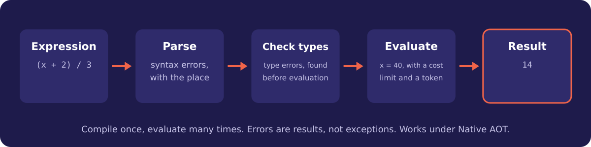

# Great.Parts.Cel


[](https://www.nuget.org/packages/Great.Parts.Cel)
[](https://www.nuget.org/packages/Great.Parts.Cel)
[](https://github.com/great-parts/great-parts-cel/actions/workflows/ci.yml)
[](https://www.bestpractices.dev/projects/16897)
[](https://scorecard.dev/viewer/?uri=github.com/great-parts/great-parts-cel)
[](https://github.com/great-parts/great-parts-cel/blob/main/LICENSE)

CEL (Common Expression Language) for .NET / C#.

[CEL](https://cel.dev/) is an expression language that is not Turing complete: an expression reads only the data that the application passes to it. An application compiles an expression once and evaluates it on different data many times. Great.Parts.Cel does both in a .NET application, under JIT and under Native AOT.

## Install

The library targets `net10.0` and `net11.0`. Add the package to a project:

```shell
dotnet add package Great.Parts.Cel
```

Messages of protobuf need a second package, `Great.Parts.Cel.Protobuf`, which depends on `Great.Parts.Cel` and `Google.Protobuf`; see [Protobuf messages](https://github.com/great-parts/great-parts-cel/blob/main/docs/protobuf.md). The type `decimal` is available on both targets, with a smaller range on `net10.0`; see [Decimal](https://github.com/great-parts/great-parts-cel/blob/main/docs/decimal.md).

## Quick start

```csharp
using Great.Parts.Cel;

CelEnvironment environment = new CelEnvironmentBuilder(CelStandardLibrary.V1)
    .AddVariable<long>("x")
    .Build()
    .GetEnvironmentOrThrow();

CelProgram<long> program = environment.Compile<long>("(x + 2) / 3").GetProgramOrThrow();

Console.WriteLine(program.Evaluate(new CelBindings().Add("x", 40L)).GetValueOrThrow()); // Output: 14
Console.WriteLine(program.Evaluate(new CelBindings().Add("x", -5L)).GetValueOrThrow()); // Output: -1
```

The environment declares what an expression may use: here the standard library and one variable `x` of the CEL type `int`. `Compile<long>` parses the expression, checks its types and returns a program. The program is immutable: it is evaluated any number of times, from any number of threads. Errors are returned as results, each with its place in the expression; `Get…OrThrow()` turns an error into an exception and keeps the example short.

## How it works



## What it covers

- **The language.** The complete CEL syntax, the type checking of the CEL language definition and the standard library, [version 1](https://github.com/great-parts/great-parts-cel/blob/main/docs/standard-library.md): arithmetic, comparisons, strings, lists, maps, `timestamp` and `duration` with time zones from a database that the application supplies or from the operating system, the standard macros, and `matches` with the syntax of RE2, found in time linear in the length of the string.
- **Extension sets.** The sets of cel-go, each added with an explicit version, and `decimal`, a set of this library, on both targets. See [Extension sets](https://github.com/great-parts/great-parts-cel/blob/main/docs/extensions.md).
- **Data of the application.** Variables and results of .NET types, and objects of the application, described by a source generator at build time, with no reflection, so they work under Native AOT and trimming ([Type mapping](https://github.com/great-parts/great-parts-cel/blob/main/docs/type-mapping.md)); messages of protobuf, in the package `Great.Parts.Cel.Protobuf`.
- **Untrusted expressions.** The length and the nesting of the text are limited, an evaluation can have a cost limit and can be cancelled ([Limits](https://github.com/great-parts/great-parts-cel/blob/main/docs/limits.md), [Cost](https://github.com/great-parts/great-parts-cel/blob/main/docs/cost.md)).
- **Errors.** A parse, type or evaluation error is a result with a code of `CelErrorCode`, a stage and a place in the expression, never an exception for a wrong expression ([Error codes](https://github.com/great-parts/great-parts-cel/blob/main/docs/error-codes.md)).

## For AI coding assistants

The package carries a file `AGENTS.md` in its root: what the library is for and when not to use it, the API with short examples, and the mistakes that are easy to make. The NuGet MCP server returns it with its tool `get_package_context` for a package that is restored on the machine, and a coding agent can read it from the package folder of the NuGet cache.

## Documentation

The documentation of a release is the content of the repository at the tag of the release. Until the release of 2.0, the links on this page point to the `main` branch of the repository.

- [README of the repository](https://github.com/great-parts/great-parts-cel/blob/main/README.md)
- [Standard library](https://github.com/great-parts/great-parts-cel/blob/main/docs/standard-library.md)
- [Extension sets](https://github.com/great-parts/great-parts-cel/blob/main/docs/extensions.md)
- [API concepts](https://github.com/great-parts/great-parts-cel/blob/main/docs/api-concepts.md)
- [Type mapping](https://github.com/great-parts/great-parts-cel/blob/main/docs/type-mapping.md)
- [Conformance](https://github.com/great-parts/great-parts-cel/blob/main/docs/conformance.md)
- [Versioning and compatibility](https://github.com/great-parts/great-parts-cel/blob/main/docs/versioning.md)
- [Changelog](https://github.com/great-parts/great-parts-cel/blob/main/CHANGELOG.md)

## License

[Apache License 2.0](https://github.com/great-parts/great-parts-cel/blob/main/LICENSE).
